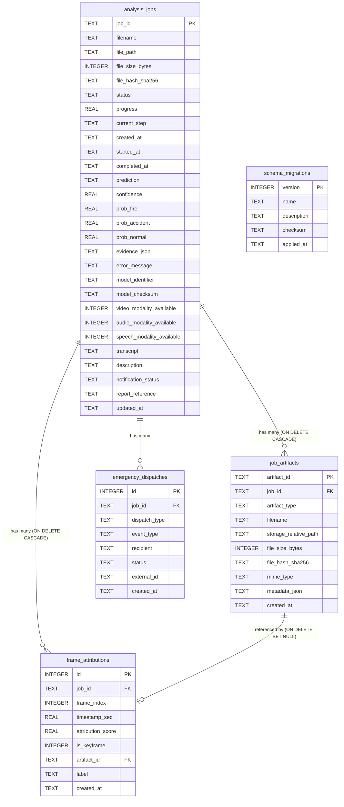

# Database Persistence & Artifact Storage Architecture

This document defines the storage layout, schema specifications, migration lifecycle, security protections, and retention policies implemented for the Multimodal Audio-Visual Scene Analysis project.

---

## 1. Managed Storage Directory Structure

Large media files, extracted frames, colormapped spectrograms, and downloadable incident reports are stored as managed files on the filesystem rather than database blobs to ensure high transaction throughput and low database memory overhead.

```text
backend/storage/
├── uploads/                              # Raw uploaded video files (preserved with content hash)
│   └── job_<job_id>_<sanitized_name>.mp4
├── artifacts/                            # Staged analysis outputs organized per job ID
│   └── job_<job_id>/
│       ├── frame_00.jpg                  # Keyframe JPEG (90% quality, resized 224x224)
│       ├── frame_03.jpg
│       ├── frame_08.jpg
│       └── spectrogram.png               # Log-mel spectrogram rendered in Viridis colormap
├── reports/                              # Pre-generated, downloadable incident reports
│   └── job_<job_id>/
│       ├── analysis_report_<job_id>.json
│       ├── analysis_report_<job_id>.md
│       ├── analysis_report_<job_id>.html
│       └── analysis_report_<job_id>.txt
└── temp/                                 # Transient worker buffers (auto-cleaned after 1 hour)
```

---

## 2. Relational Schema & Entity Relationships

The storage layer is implemented in SQLite using **Write-Ahead Logging (WAL)** mode for concurrent readers and non-blocking background workers (`PRAGMA journal_mode = WAL; PRAGMA foreign_keys = ON;`).



### Table Specifications

1. **`analysis_jobs`**: Core tracking entity. Retains full lifecycle statuses (`queued`, `processing`, `completed`, `failed`, `cancelled`), class prediction probabilities, the exact model checksum (`model_checksum`) used for inference, individual modality presence (`video`, `audio`, `speech`), the raw Kannada ASR transcript, user-provided notes (`description`), and notification audit state.
2. **`job_artifacts`**: Managed file ledger. Tracks the exact relative location, MIME type, SHA-256 content checksum, and structured metadata for every physical file on disk.
3. **`frame_attributions`**: Frame-level attention and motion saliency scores ($0.0 \dots 1.0$) mapped to video timestamps ($t$ in seconds). Identifies peak keyframes and links to their rendered JPEG artifacts.
4. **`emergency_dispatches`**: Full audit trail of initiated notifications (WhatsApp alerts, Twilio phone calls, Twilio SMS) linked to the triggering incident job.
5. **`schema_migrations`**: Versioned history of database schema updates with SHA-256 script verification.

---

## 3. Versioned Migrations System

Schema evolution is governed by an automated migration engine in `backend/migrations.py`. All migrations are:
- **Versioned & Sequential**: Applied in strictly ascending version order ($1 \to 2 \to \dots \to N$).
- **Atomic**: Each migration executes inside a database transaction (`with conn:`).
- **Non-Destructive**: All table modifications preserve existing records without dropping tables or discarding history.
- **Idempotent**: Re-running migration checks safely detects already-applied versions and exits without modifying the schema.

### Applied Migrations

| Version | Migration Name | Scope & Changes |
|:---:|:---|:---|
| **1** | `001_baseline_tables` | Baseline tables (`analysis_jobs`, `emergency_dispatches`, `system_logs`) and primary status/timestamp indexes. |
| **2** | `002_add_model_and_modality_columns` | Non-destructive column additions: `model_identifier`, `model_checksum`, `video_modality_available`, `audio_modality_available`, `speech_modality_available`, `transcript`, `description`, `notification_status`, `report_reference`, `updated_at`. |
| **3** | `003_create_job_artifacts_table` | Created `job_artifacts` table with foreign key to `analysis_jobs` (`ON DELETE CASCADE`) and lookup indexes on `job_id` and `artifact_type`. |
| **4** | `004_create_frame_attributions_table` | Created `frame_attributions` table with foreign keys to `analysis_jobs` and `job_artifacts`, indexing attribution scores and frame order. |
| **5** | `005_performance_and_audit_indexes` | Added composite indexes: `idx_jobs_file_hash`, `idx_jobs_status_created`, and `idx_dispatches_status`. |

---

## 4. Security & Path Protection

To prevent sensitive information leakage and protect server integrity:
1. **Never Expose Internal Host Paths**: Public API responses serialize paths relative to the API gateway (e.g. `/api/jobs/{job_id}/artifacts/{artifact_id}`) and strip all raw server filesystem paths (e.g. `C:\Users\Hp\...` or `/var/www/...`).
2. **Strict Path Traversal Guard**: All file resolution passes through `resolve_safe_path(storage_relative_path)`:
   - Absolute paths (starting with `/`, `\`, or drive letters like `C:`) are immediately rejected with a `PermissionError`.
   - Paths containing directory traversal sequences (`../`, `..\`) are resolved relative to `STORAGE_ROOT` and must be descendants of `STORAGE_ROOT`.
   - Access attempts outside `STORAGE_ROOT` return an HTTP 403 Forbidden.
3. **Foreign Key Integrity**: Direct artifact downloads require matching `job_id` and `artifact_id` pairs, preventing cross-tenant or unauthorized file access.

---

## 5. Duplicate Prevention (Content-Hash Deduplication)

To protect compute resources from redundant heavy inference:
1. When a video is submitted to `POST /api/jobs/analyze`, its SHA-256 hash is computed.
2. The engine queries `analysis_jobs` for any existing record with matching `file_hash_sha256` and `status = 'completed'`.
3. If an existing job is found and `force_reanalysis=false` (default):
   - The API immediately returns HTTP 200 with the existing completed job record, marked with `"cached": true` and `"is_duplicate": true`.
   - No redundant video decoding, audio extraction, or neural inference is executed.
4. If `force_reanalysis=true` is supplied, the system bypasses the cache and creates a fresh analysis job.

---

## 6. Configurable Storage Retention & Cleanup Policy

Retention and cleanup policies protect host storage from unbounded disk growth:

### Policy Parameters

- `STORAGE_RETENTION_DAYS` (Default: `30` days): Incidents older than this threshold have their associated media files and generated artifacts purged.
- `MAX_STORAGE_MB` (Default: `5000` MB): Ceiling for total managed media storage.
- `CLEANUP_FAILED_JOBS_HOURS` (Default: `24` hours): Truncates failed or cancelled jobs that did not produce valuable evidence.
- `TEMP_FILE_EXPIRY` (Default: `1` hour): Removes transient files created in `storage/temp/`.

### Automated Cleanup API

- **Endpoint**: `POST /api/storage/cleanup`
- **Query Parameters**:
  - `retention_days` (optional integer override)
  - `max_storage_mb` (optional integer override)
  - `clean_orphans` (boolean, default `true`): Deletes unindexed files located in `uploads/` or `artifacts/` that lack database records.
  - `dry_run` (boolean, default `false`): Simulates cleanup and returns an audit report of files and bytes that would be deleted without modifying disk.

---

## 7. Artifact & Storage API Endpoints

### 1. List Artifacts for a Job
- **`GET /api/jobs/{job_id}/artifacts`**
- **Response `200 OK`**:
```json
{
  "job_id": "job_1900a4ecea00",
  "total_artifacts": 6,
  "artifacts": [
    {
      "artifact_id": "art_vid_8f3a9e2b10",
      "artifact_type": "video",
      "filename": "highway_traffic.mp4",
      "file_size_bytes": 10485760,
      "mime_type": "video/mp4",
      "created_at": "2026-10-27T14:48:15",
      "download_url": "/api/jobs/job_1900a4ecea00/artifacts/art_vid_8f3a9e2b10"
    },
    {
      "artifact_id": "art_frame_3b1d7f8c2e",
      "artifact_type": "keyframe",
      "filename": "frame_03.jpg",
      "file_size_bytes": 28410,
      "mime_type": "image/jpeg",
      "created_at": "2026-10-27T14:48:18",
      "download_url": "/api/jobs/job_1900a4ecea00/artifacts/art_frame_3b1d7f8c2e",
      "metadata": {
        "frame_index": 3,
        "timestamp_sec": 1.25,
        "is_keyframe": true
      }
    },
    {
      "artifact_id": "art_spec_9c2a11de4f",
      "artifact_type": "spectrogram",
      "filename": "spectrogram.png",
      "file_size_bytes": 54200,
      "mime_type": "image/png",
      "created_at": "2026-10-27T14:48:20",
      "download_url": "/api/jobs/job_1900a4ecea00/artifacts/art_spec_9c2a11de4f",
      "metadata": {
        "mel_bins": 64,
        "time_steps": 313,
        "colormap": "viridis"
      }
    }
  ]
}
```

### 2. Download Job Artifact
- **`GET /api/jobs/{job_id}/artifacts/{artifact_id}`**
- **Response**: Binary stream with appropriate `Content-Type` header (`image/jpeg`, `image/png`, `video/mp4`, `text/markdown`, etc.) and sanitized filename attachment.

### 3. Retrieve Frame Attributions
- **`GET /api/jobs/{job_id}/attributions`**
- **Response `200 OK`**:
```json
{
  "job_id": "job_1900a4ecea00",
  "total_frames_attributed": 12,
  "attributions": [
    {
      "frame_index": 0,
      "timestamp_sec": 0.0,
      "attribution_score": 0.21,
      "is_keyframe": false,
      "attribution_url": null,
      "label": "Frame 0 (0.0s) - Sampled"
    },
    {
      "frame_index": 3,
      "timestamp_sec": 1.25,
      "attribution_score": 0.94,
      "is_keyframe": true,
      "attribution_url": "/api/jobs/job_1900a4ecea00/artifacts/art_frame_3b1d7f8c2e",
      "label": "Frame 3 (1.25s) - Keyframe Peak"
    }
  ]
}
```

### 4. Storage Policy & Utilization
- **`GET /api/storage/policy`**
- **Response `200 OK`**:
```json
{
  "retention_policy": {
    "retention_days": 30,
    "max_storage_mb": 5000,
    "cleanup_failed_jobs_hours": 24
  },
  "storage_breakdown": {
    "uploads": {"bytes": 3422925, "mb": 3.26, "files": 7},
    "artifacts": {"bytes": 284100, "mb": 0.27, "files": 12},
    "reports": {"bytes": 15200, "mb": 0.01, "files": 8},
    "temp": {"bytes": 0, "mb": 0.0, "files": 0},
    "total_managed": {"bytes": 3722225, "mb": 3.55, "total_files": 27}
  },
  "host_disk": {
    "total_bytes": 917051011072,
    "free_bytes": 94184062976,
    "free_gb": 87.72,
    "used_gb": 766.35
  }
}
```

### 5. Update Job Description or Notification Status
- **`PATCH /api/jobs/{job_id}`**
- **Request Body**:
```json
{
  "description": "Highway 4 collision confirmed by highway patrol",
  "notification_status": "dispatched"
}
```
